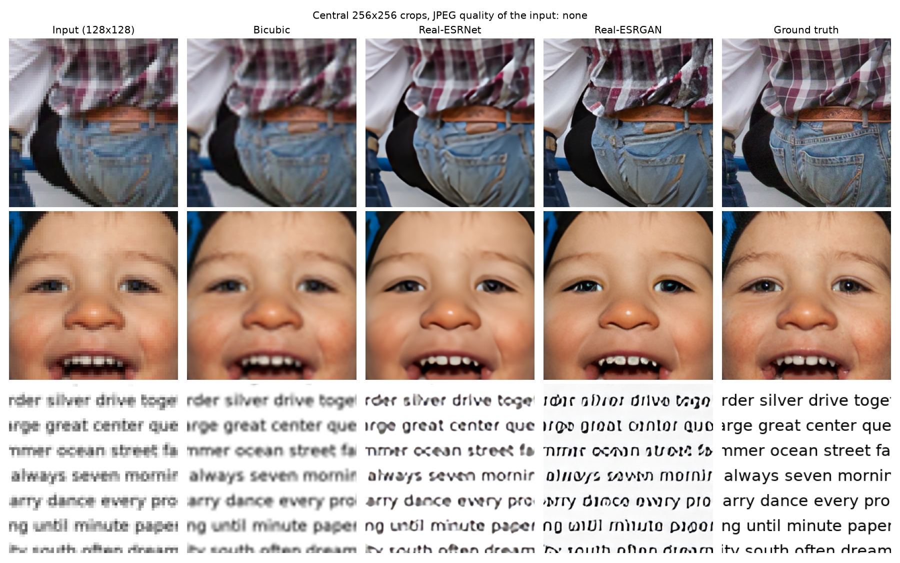

# Image Super-Resolution with Deep Generative Models

Computer Vision 2026 course project. Team: Iuliia Kurnaeva, Alena Petrenko, Amaliya Kharisova, Dmitrii Kuznetsov.

**Question.** How much fidelity do pretrained generative ×4 super-resolution models give up for perceptual quality compared with a non-generative baseline, and how does this depend on image content (text, faces, objects) and JPEG compression strength?

All models are pretrained. Nothing is trained in this project.

## Current state

| Stage | Status |
|---|---|
| Data loading and preprocessing | done |
| Baselines: bicubic interpolation and Real-ESRNet | done, evaluated on the dev split |
| GAN: Real-ESRGAN | done, evaluated on the dev split |
| Diffusion: ResShift | next |
| Perceptual and task metrics (MUSIQ, OCR error rate, face identity), test split | later |

Stage reports are in [`reports/`](reports/).

## Data

340 ground-truth images of 512×512 pixels in three content types.

| Content | Source | Test | Dev |
|---|---|---|---|
| Objects & scenes | [DIV2K](https://data.vision.ee.ethz.ch/cvl/DIV2K/) validation images 0801–0900, central 512×512 crop | 80 | 20 |
| Faces | 120 images sampled from [FFHQ](https://github.com/NVlabs/ffhq-dataset) 00000–00999, resized 1024 → 512 | 100 | 20 |
| Text | Rendered by us: 3 fonts × 4 font sizes (16, 24, 32, 48 px) × dictionary words or random codes | 96 | 24 |

Each ground-truth image is reduced ×4 with bicubic interpolation to 128×128 and then JPEG-compressed at quality none, 50, 30 and 10. Every image gets every JPEG level, which gives 1,360 low-resolution inputs.

There is no training split. The dev split is used for debugging and for choosing settings. The test split is kept for the final numbers and has not been run yet.

## Pipeline

1. `code/datasets/download_data.py`: download the DIV2K validation set (449 MB), 120 FFHQ images chosen with a fixed seed, and the Real-ESRNet and Real-ESRGAN weights (64 MB each). Files that already exist are skipped.

2. `code/datasets/prepare_data.py`: build the ground-truth images, split them into dev and test by source image, create the low-resolution inputs, and check that no source image or text appears in both splits. Save `manifest.csv` (one row per image) and `data_report.json`.

3. `code/models/upscale.py`: upscale every low-resolution input of a split ×4 with bicubic interpolation, Real-ESRNet and Real-ESRGAN. Real-ESRNet and Real-ESRGAN use the same RRDBNet network and training data and differ only in the loss (L1 vs. L1 + perceptual + GAN), so comparing them isolates the effect of generative training. Save the outputs as PNG and the timing to `results/upscale_report_dev.json`.

4. `code/evaluation/evaluate.py`: compare each output with its ground truth. PSNR and SSIM are computed on the Y channel with a 4-pixel border crop (the standard super-resolution protocol); LPIPS uses AlexNet. Save per-image metrics, means with 95% bootstrap confidence intervals, and the paired differences Real-ESRNet − bicubic and Real-ESRGAN − Real-ESRNet.

5. `code/evaluation/make_figures.py`: plot the metrics against JPEG quality and save example comparisons.

`notebooks/data_overview.ipynb` shows the prepared data.

## Pipeline flow

1. `download_data.py`: `download_div2k` → `choose_face_ids` → `download_faces` → `download_weights`.
2. `prepare_data.py`: `build_objects` (`crop_center`) → `build_faces` → `build_text` (`render_text_set` from `render_text.py`) → `make_low_resolution` (`compress_jpeg`) → `check_leakage` → save the manifest and the report.
3. `upscale.py`: `pick_device` → `load_rrdbnet` (`RRDBNet` from `rrdbnet.py`) → `run_method` (`upscale_bicubic`, `upscale_rrdbnet`) → save the outputs and the report.
4. `evaluate.py`: `check_metrics` → `evaluate_split` (`compute_psnr`, `compute_ssim`, `compute_lpips`) → `summarize` → `compare_methods` → save the tables.
5. `make_figures.py`: `plot_jpeg_sweep` → `plot_examples`.

## Run

Tested with Python 3.14. The code uses an NVIDIA GPU if there is one, then an Apple GPU, then the CPU. Run the following commands from the repository root:

```bash
python3 -m venv .venv
source .venv/bin/activate
python -m pip install -r requirements.txt
bash run_pipeline.sh
```

`run_pipeline.sh` downloads the data (about 10 minutes, 720 MB), prepares it (30 seconds), runs bicubic, Real-ESRNet and Real-ESRGAN on the dev split (2 minutes on an NVIDIA RTX 3080 Ti Laptop GPU) and evaluates them (1 minute). Each run overwrites the outputs and the result tables.

The steps can also be run one at a time:

```bash
python code/datasets/download_data.py
python code/datasets/prepare_data.py
python code/models/upscale.py --split dev
python code/evaluation/evaluate.py --split dev
python code/evaluation/make_figures.py --split dev
```

## Results (dev split, 64 images)

Mean over images. Input without JPEG compression:

| Content | Method | PSNR (dB) ↑ | SSIM ↑ | LPIPS ↓ |
|---|---|---|---|---|
| Objects | Bicubic | 25.62 | 0.689 | 0.488 |
| Objects | Real-ESRNet | 26.31 | 0.737 | 0.376 |
| Objects | Real-ESRGAN | 24.44 | 0.682 | 0.255 |
| Faces | Bicubic | 33.40 | 0.879 | 0.289 |
| Faces | Real-ESRNet | 33.76 | 0.894 | 0.238 |
| Faces | Real-ESRGAN | 31.05 | 0.859 | 0.159 |
| Text | Bicubic | 16.46 | 0.707 | 0.436 |
| Text | Real-ESRNet | 19.31 | 0.838 | 0.186 |
| Text | Real-ESRGAN | 17.83 | 0.818 | 0.107 |

Real-ESRGAN has the lowest LPIPS for every content type but loses 1.5–2.7 dB PSNR against Real-ESRNet, the same network trained without the GAN loss. On every content type and JPEG level the difference is larger than its 95% confidence interval.

All JPEG levels with confidence intervals: [`results/summary_dev.csv`](results/summary_dev.csv). Paired differences: [`results/paired_dev.csv`](results/paired_dev.csv).




Runtime on an NVIDIA RTX 3080 Ti Laptop GPU, float32, 128×128 → 512×512, batch size 1: bicubic 0.002 s per image, Real-ESRNet 0.11 s per image, Real-ESRGAN 0.11 s per image (the same network). Timing on an NVIDIA T4 will be added.

## Repository layout

```
code/datasets/      download, text rendering, data preparation
code/models/        RRDBNet definition, upscaling script
code/evaluation/    metrics and figures
data/processed/     manifest.csv and data_report.json (images are regenerated by the pipeline)
models/             downloaded weights (not tracked)
notebooks/          data overview
reports/            stage reports
results/            metric tables and figures
```

## Team

| Member | Builds | Analyses and presents |
|---|---|---|
| Amaliya Kharisova | Dataset download, degradation pipeline, text generator, splits | Text |
| Dmitrii Kuznetsov | Bicubic, Real-ESRNet, Real-ESRGAN, runtime | Objects & scenes |
| Iuliia Kurnaeva | ResShift, random-seed experiment | Faces |
| Alena Petrenko | Metrics, statistics, figures, README & reproducibility | JPEG compression |

## Credits

- Real-ESRNet / Real-ESRGAN: X. Wang et al., ICCVW 2021, [xinntao/Real-ESRGAN](https://github.com/xinntao/Real-ESRGAN) (BSD-3). The RRDBNet definition follows [BasicSR](https://github.com/XPixelGroup/BasicSR) (Apache-2.0).
- DIV2K: Agustsson & Timofte, CVPRW 2017 (academic use). FFHQ: Karras et al., CVPR 2019 (CC BY-NC-SA 4.0), downloaded from the [marcosv/ffhq-dataset](https://huggingface.co/datasets/marcosv/ffhq-dataset) mirror.
- LPIPS: Zhang et al., CVPR 2018.
