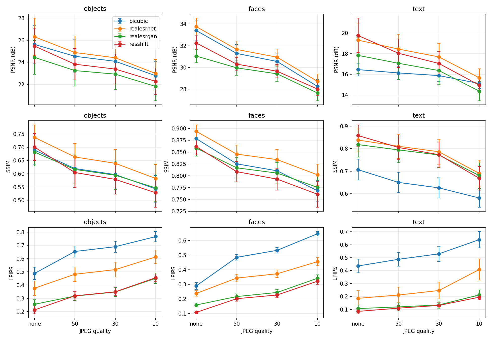
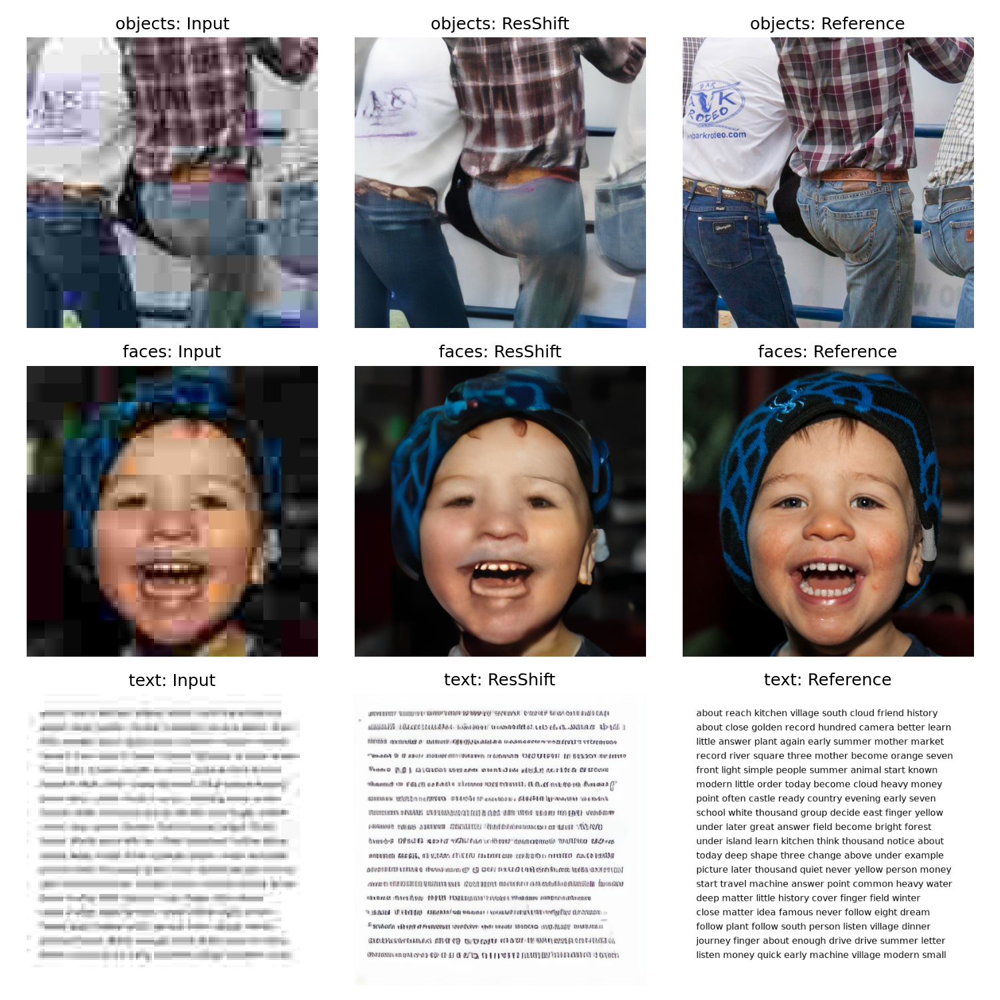

# Image Super-Resolution with Deep Generative Models

Computer Vision 2026 course project. Team: Iuliia Kurnaeva, Alena Petrenko, Amaliya Kharisova, Dmitrii Kuznetsov.

**Question.** How much fidelity do pretrained generative ×4 super-resolution models give up for perceptual quality compared with a non-generative baseline, and how does this depend on image content (text, faces, objects) and JPEG compression strength?

All models are pretrained. Nothing is trained in this project.

## Current state

| Stage | Status |
|---|---|
| Data loading and preprocessing | done |
| Baselines: bicubic interpolation and Real-ESRNet | done, original dev results retained |
| GAN: Real-ESRGAN | done, original dev results retained |
| Diffusion: ResShift | done, verified dev run in Colab |
| PSNR, SSIM and LPIPS evaluation | done |
| JPEG degradation sweep | done for quality none, 50, 30 and 10 |
| Perceptual and task metrics (MUSIQ, OCR error rate, face identity) | pending |
| ResShift variability across sampling seeds | pending |
| Final test evaluation with frozen settings | pending; earlier exploratory test run archived |

Stage reports are in [`reports/`](reports/). The latest is [Stage 4: diffusion and project progress](reports/stage4_diffusion.pdf).

The current comparison combines the original baseline results from `896fe8c` with a ResShift-only Colab run on the exact same archived dev inputs. The earlier all-method Colab test results are preserved under [`results/legacy_colab/`](results/legacy_colab/) as exploratory results. The test split has already been accessed; it must not be described as untouched.

## Data

340 ground-truth images of 512×512 pixels in three content types.

| Content | Source | Test | Dev |
|---|---|---:|---:|
| Objects & scenes | [DIV2K](https://data.vision.ee.ethz.ch/cvl/DIV2K/) validation images 0801–0900, central 512×512 crop | 80 | 20 |
| Faces | 120 images sampled from [FFHQ](https://github.com/NVlabs/ffhq-dataset) 00000–00999, resized 1024 → 512 | 100 | 20 |
| Text | Rendered by us: 3 fonts × 4 font sizes (16, 24, 32, 48 px) × dictionary words or random codes | 96 | 24 |

Each ground-truth image is reduced ×4 with bicubic interpolation to 128×128 and then JPEG-compressed at quality none, 50, 30 and 10. Every image gets every JPEG level, which gives 1,360 low-resolution inputs.

There is no training split: all restoration models use pretrained weights. The dev split contains 64 images and is used for debugging and preliminary comparisons. The test split contains 276 images and is used for the final evaluation. The split was generated with seed 42, with no overlap between dev and test source images.

## Pipeline

1. `code/datasets/download_data.py`: download the DIV2K validation set (449 MB), 120 FFHQ images chosen with a fixed seed, and the Real-ESRNet and Real-ESRGAN weights (64 MB each). Files that already exist are skipped.

2. `code/datasets/prepare_data.py`: build the ground-truth images, split them into dev and test by source image, create the low-resolution inputs, and check that no source image or text appears in both splits. Save `manifest.csv` (one row per image) and `data_report.json`.

3. `code/models/upscale.py`: upscale every low-resolution input of a split ×4 with bicubic interpolation, Real-ESRNet, Real-ESRGAN and ResShift diffusion. Real-ESRNet and Real-ESRGAN use the same RRDBNet network and training data and differ only in the loss (L1 vs. L1 + perceptual + GAN), so comparing them isolates the effect of generative training. Save the outputs as PNG and the timing to `results/upscale_report_<split>.json`.

   ResShift is integrated from the official implementation at a pinned commit (`bb03b7d`). The setup script is `code/models/setup_resshift.sh`. Pretrained checkpoints are downloaded by `code/datasets/download_data.py`. The diffusion sampler uses a stable per-image seed that is reused across JPEG conditions, making comparisons between compression levels more reproducible.

4. `code/evaluation/evaluate.py`: compare each output with its ground truth. PSNR and SSIM are computed on the Y channel with a 4-pixel border crop (the standard super-resolution protocol); LPIPS uses AlexNet. The script saves per-image metrics and aggregate summaries. Check the generated evaluation reports for the exact confidence-interval and paired-comparison settings.

5. `code/evaluation/make_figures.py`: plot the metrics against JPEG quality and save example comparisons.

`notebooks/data_overview.ipynb` shows the prepared data.

## Pipeline flow

1. `download_data.py`: `download_div2k` → `choose_face_ids` → `download_faces` → `download_weights`.
2. `prepare_data.py`: `build_objects` (`crop_center`) → `build_faces` → `build_text` (`render_text_set` from `render_text.py`) → `make_low_resolution` (`compress_jpeg`) → `check_leakage` → save the manifest and the report.
3. `upscale.py`: `pick_device` → load RRDBNet or ResShift → `run_method` (`upscale_bicubic`, `upscale_rrdbnet`, `ResShift.upscale`) → save outputs and the report.
4. `evaluate.py`: `check_metrics` → `evaluate_split` (`compute_psnr`, `compute_ssim`, `compute_lpips`) → `summarize` → `compare_methods` → save the tables.
5. `make_figures.py`: `plot_jpeg_sweep` → `plot_examples`.

## Run

The local pipeline was tested with Python 3.14; the recorded ResShift run used Python 3.13.16 in Colab. To reproduce the reported diffusion experiment, use the Colab notebook below. The general pipeline uses an NVIDIA GPU if there is one, then an Apple GPU, then the CPU. Run the following commands from the repository root:

```bash
python3 -m venv .venv
source .venv/bin/activate
python -m pip install -r requirements.txt
bash run_pipeline.sh
```

`run_pipeline.sh` regenerates the data and runs all four methods on dev. It is a general pipeline, not the procedure used for the archived ResShift-only experiment; regenerating text images on another system can change the inputs. To evaluate both dev and test splits, run the corresponding commands for each split as shown below. The pipeline includes the pinned ResShift implementation, checkpoint download, dataset preparation, upscaling, metric evaluation and figure generation. ResShift is substantially slower than the RRDBNet-based methods; runtime depends on the available accelerator. Each run may overwrite existing outputs and result tables.

### Google Colab

1. Open [`notebooks/ResShift_only_dev.ipynb`](notebooks/ResShift_only_dev.ipynb) in Colab and select a GPU runtime. The committed notebook includes the completed T4 run and its outputs.
2. Download [`data/resshift_dev_bundle.zip`](data/resshift_dev_bundle.zip) from this repository and upload it to `/content/resshift_dev_bundle.zip` through the Colab file panel.
3. Run the notebook cells in order. They extract the existing images, install dependencies without replacing the Colab PyTorch/torchvision pair, load the pinned ResShift code and run diffusion on dev only. No dataset generation or baseline inference is performed.
4. Download `resshift_dev_results.zip` from the final cell and save the executed notebook with outputs.

The input archive is stored byte-for-byte so the archived experiment does not depend on cross-platform text rendering. It contains only dev image files. Sampling seeds are fixed per image and reused across all four JPEG levels. Settings, input and checkpoint hashes, package versions and per-image timing are under [`results/resshift_dev/`](results/resshift_dev/).

The steps can also be run one at a time:

```bash
python code/datasets/download_data.py
python code/datasets/prepare_data.py

# Set up the official ResShift implementation once
bash code/models/setup_resshift.sh

# Run the dev split
python code/models/upscale.py --split dev
python code/evaluation/evaluate.py --split dev
python code/evaluation/make_figures.py --split dev

# Final test evaluation after settings are frozen (not part of the recorded dev run)
python code/models/upscale.py --split test
python code/evaluation/evaluate.py --split test
python code/evaluation/make_figures.py --split test
```

## Preliminary results (dev split, 64 images)

Mean over images. Input without JPEG compression:

| Content | Method | PSNR (dB) ↑ | SSIM ↑ | LPIPS ↓ |
|---|---|---:|---:|---:|
| Objects | Bicubic | 25.62 | 0.689 | 0.488 |
| Objects | Real-ESRNet | 26.31 | 0.737 | 0.376 |
| Objects | Real-ESRGAN | 24.44 | 0.682 | 0.255 |
| Objects | ResShift | 25.47 | 0.701 | 0.212 |
| Faces | Bicubic | 33.40 | 0.879 | 0.289 |
| Faces | Real-ESRNet | 33.76 | 0.894 | 0.238 |
| Faces | Real-ESRGAN | 31.05 | 0.859 | 0.159 |
| Faces | ResShift | 32.26 | 0.862 | 0.108 |
| Text | Bicubic | 16.46 | 0.707 | 0.436 |
| Text | Real-ESRNet | 19.31 | 0.838 | 0.186 |
| Text | Real-ESRGAN | 17.83 | 0.818 | 0.107 |
| Text | ResShift | 19.76 | 0.858 | 0.085 |

Without JPEG, ResShift has the lowest mean LPIPS in every content category and improves mean PSNR over Real-ESRGAN. Real-ESRNet retains the highest PSNR and SSIM on objects and faces; ResShift has the highest values on text. Under heavy JPEG compression the picture changes: at quality 10, ResShift has lower SSIM than Real-ESRGAN in all three categories, and slightly worse LPIPS on objects. These metric improvements do not establish correct text recognition or preserved face identity.

All JPEG levels: [`results/summary_dev.csv`](results/summary_dev.csv). Paired differences: [`results/paired_dev.csv`](results/paired_dev.csv).



ResShift at JPEG quality 10 (input, reconstruction, reference):



The earlier three-method example without JPEG remains in [`examples_dev_jpeg_none.png`](results/figures/examples_dev_jpeg_none.png).

## Evaluation still to complete

MUSIQ, OCR character/word error rates, face-identity similarity and the multiple-seed ResShift study are pending. Final evaluation on the original 276-image test split will follow frozen settings and must document the earlier exploratory test access. Existing exploratory test files are retained in [`results/legacy_colab/`](results/legacy_colab/).

ResShift averaged **0.909 seconds per image** on the Tesla T4 after three warm-up calls. Baseline timings were measured on an RTX 3080 Ti Laptop GPU, so they are not a controlled speed comparison. A common-hardware benchmark and review of confidence-interval reporting remain to be completed.

## Repository layout

```text
code/datasets/      download, text rendering, data preparation
code/models/        RRDBNet definition, upscaling script and ResShift setup
code/evaluation/    metrics and figures
data/processed/     dataset manifest and preparation report
data/resshift_dev_bundle.zip  frozen original dev inputs, baseline tables and code for Colab
models/             downloaded weights (not tracked)
third_party/        pinned ResShift source (not tracked)
notebooks/          data overview and executed ResShift Colab experiment
reports/            stage reports
results/            current dev tables and figures
results/resshift_dev/  diffusion tables, environment, seeds and provenance
results/legacy_colab/  earlier exploratory test results
outputs/            super-resolution outputs by split, method and JPEG condition
```

## Team

| Member | Builds | Analyses and presents |
|---|---|---|
| Amaliya Kharisova | Dataset download, degradation pipeline, text generator, splits | Text |
| Dmitrii Kuznetsov | Bicubic, Real-ESRNet, Real-ESRGAN, runtime | Objects & scenes |
| Iuliia Kurnaeva | ResShift, random-seed experiment | Faces |
| Alena Petrenko | Metrics, statistics, figures, README & reproducibility | JPEG compression |

## Diffusion integration notes

ResShift is loaded from the official repository at a pinned commit (`bb03b7d`). The setup script clones that source into `third_party/ResShift/` (ignored by Git); the two pretrained checkpoints are downloaded into `models/` by `code/datasets/download_data.py`. ResShift outputs are saved under `outputs/<split>/resshift/jpeg_<quality>/`, following the same output layout as the other methods. Its stochastic sampler receives a stable per-image seed, reused across JPEG conditions.

The current dev tables contain 1,024 rows: 768 original baseline measurements and 256 new ResShift measurements, across all four JPEG conditions. The executed notebook and frozen archive are the reproduction entry point for this comparison. Full upscaled images are exported by the notebook and are not tracked in Git. Earlier exploratory test results are stored separately; the final evaluation and multiple-seed study remain pending.

## Credits

- Real-ESRNet / Real-ESRGAN: X. Wang et al., ICCVW 2021, [xinntao/Real-ESRGAN](https://github.com/xinntao/Real-ESRGAN) (BSD-3). The RRDBNet definition follows [BasicSR](https://github.com/XPixelGroup/BasicSR) (Apache-2.0).
- DIV2K: Agustsson & Timofte, CVPRW 2017 (academic use). FFHQ: Karras et al., CVPR 2019 (CC BY-NC-SA 4.0), downloaded from the [marcosv/ffhq-dataset](https://huggingface.co/datasets/marcosv/ffhq-dataset) mirror.
- LPIPS: Zhang et al., CVPR 2018.
