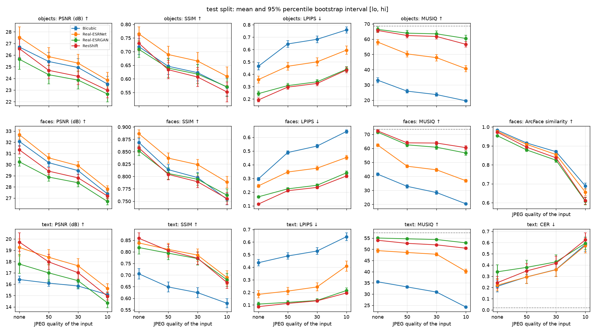
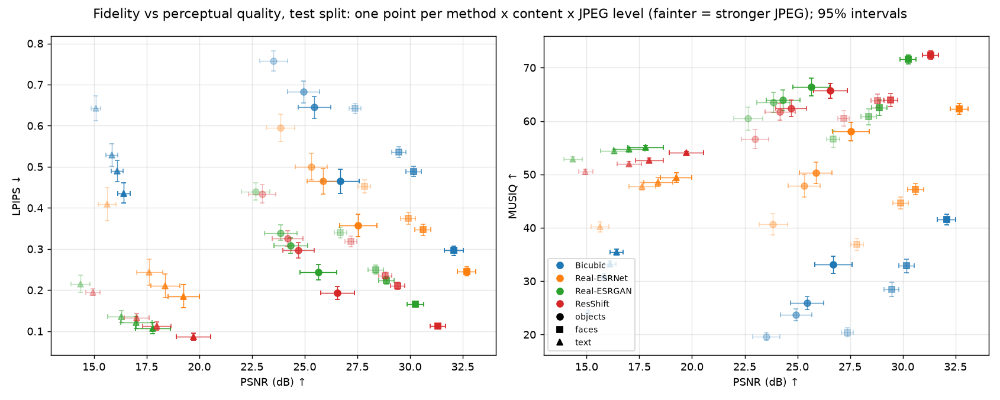
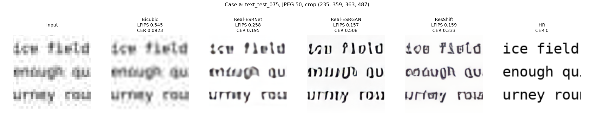
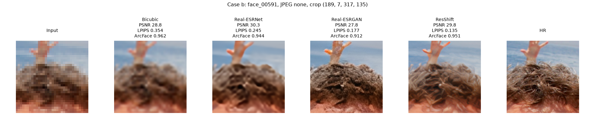
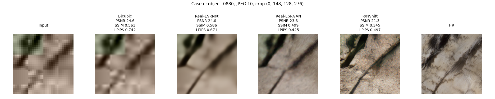
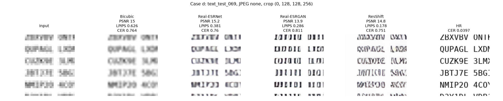

# Stage 5 Report: Final Evaluation and Analysis

**Image Super-Resolution with Deep Generative Models · Computer Vision 2026 · 3 Nov 2026** Team: Iuliia Kurnaeva, Alena Petrenko, Amaliya Kharisova, Dmitrii Kuznetsov

**Repository:** https://github.com/Ephy01/Image-Super-Resolution-with-Deep-Generative-Models

## 1. Completed experiments

Four pretrained methods ran on every input: bicubic, Real-ESRNet, Real-ESRGAN and ResShift v3 (4 steps). Nothing is trained. The test split has 276 images (80 objects, 100 faces, 96 text), downsampled ×4 to 128×128 and compressed at JPEG none, 50, 30 and 10: 1,104 inputs per method. Dev has 64 images.

- **Hardware.** Tesla T4, batch size 1. Real-ESRNet and Real-ESRGAN use float32; ResShift uses float32 weights with float16 autocast. Bicubic runs on the notebook CPU. Metrics ran on an Apple M4 CPU.
- **Frozen settings.** `configs/final.yaml` (SHA-256 `70f6c341`) was frozen before the test run from dev HR images only. OCR: Tesseract 5.5.1, `--psm 4 --oem 1`, the best of 18 candidates, HR CER 0.017 on dev. ArcFace: buffalo_l with a 512 px detector input (640 px missed 12 of 20 dev faces); match threshold 0.182, the 1% false match rate on 190 dev impostor pairs. MUSIQ: KonIQ-10k checkpoint. ResShift: seed offsets 0 to 4. Intervals: 95% percentile bootstrap [lo, hi], 10,000 resamples, seed 42, no multiple-comparison correction. The analysis and failure-selection rules are in the same file.
- **Reproduction.** With Pillow's BASIC text layout, 320 of 320 dev inputs equal the stage 4 archive. Bicubic, Real-ESRNet and Real-ESRGAN reproduce the archived per-image metrics within tolerance: at most 0.0049 dB PSNR, 0.0002 SSIM and 0.0005 LPIPS. ResShift does not: at most 0.032 dB PSNR (18 of 256 values above 0.01 dB) and 0.0013 LPIPS; the mean absolute PSNR difference is 0.0035 dB. The inputs and weights match; the model computation is unchanged. Stage 4 used CUDA 13.0 and this run CUDA 12.8, which probably explains the difference.

## 2. Final results (test split, 276 images)

PSNR and SSIM on the Y channel with a 4-pixel border crop; LPIPS with AlexNet; MUSIQ is no-reference. Last 2 columns: CER for text; ArcFace similarity to the HR face and match rate for faces. Means over images; best per content and condition in bold.

**No JPEG**

| Content | Method | PSNR ↑ | SSIM ↑ | LPIPS ↓ | MUSIQ ↑ | CER ↓ / ArcFace sim ↑ | Match rate ↑ |
|---|---|---:|---:|---:|---:|---:|---:|
| Objects | Bicubic | 26.69 | 0.718 | 0.465 | 33.1 | n/a | n/a |
| Objects | Real-ESRNet | **27.54** | **0.765** | 0.357 | 58.1 | n/a | n/a |
| Objects | Real-ESRGAN | 25.65 | 0.709 | 0.244 | **66.4** | n/a | n/a |
| Objects | ResShift | 26.56 | 0.731 | **0.192** | 65.7 | n/a | n/a |
| Objects | HR reference | n/a | n/a | n/a | 68.6 | n/a | n/a |
| Faces | Bicubic | 32.08 | 0.869 | 0.296 | 41.5 | **0.983** | **1.00** |
| Faces | Real-ESRNet | **32.68** | **0.886** | 0.245 | 62.3 | 0.977 | 1.00 |
| Faces | Real-ESRGAN | 30.25 | 0.852 | 0.166 | 71.5 | 0.954 | 1.00 |
| Faces | ResShift | 31.32 | 0.858 | **0.113** | **72.4** | 0.972 | 1.00 |
| Faces | HR reference | n/a | n/a | n/a | 73.6 | n/a | n/a |
| Text | Bicubic | 16.42 | 0.706 | 0.436 | 35.5 | **0.210** | n/a |
| Text | Real-ESRNet | 19.25 | 0.838 | 0.184 | 49.4 | 0.220 | n/a |
| Text | Real-ESRGAN | 17.79 | 0.819 | 0.107 | **55.0** | 0.340 | n/a |
| Text | ResShift | **19.72** | **0.859** | **0.086** | 54.0 | 0.243 | n/a |
| Text | HR reference | n/a | n/a | n/a | 57.4 | 0.019 | n/a |

**JPEG 10**

| Content | Method | PSNR ↑ | SSIM ↑ | LPIPS ↓ | MUSIQ ↑ | CER ↓ / ArcFace sim ↑ | Match rate ↑ |
|---|---|---:|---:|---:|---:|---:|---:|
| Objects | Bicubic | 23.52 | 0.570 | 0.758 | 19.6 | n/a | n/a |
| Objects | Real-ESRNet | **23.85** | **0.609** | 0.595 | 40.7 | n/a | n/a |
| Objects | Real-ESRGAN | 22.67 | 0.571 | 0.440 | **60.5** | n/a | n/a |
| Objects | ResShift | 22.98 | 0.552 | **0.434** | 56.7 | n/a | n/a |
| Objects | HR reference | n/a | n/a | n/a | 68.6 | n/a | n/a |
| Faces | Bicubic | 27.38 | 0.754 | 0.642 | 20.4 | **0.689** | 0.96 |
| Faces | Real-ESRNet | **27.83** | **0.789** | 0.453 | 36.9 | 0.656 | **1.00** |
| Faces | Real-ESRGAN | 26.70 | 0.762 | 0.340 | 56.7 | 0.608 | 1.00 |
| Faces | ResShift | 27.19 | 0.755 | **0.318** | **60.5** | 0.611 | 1.00 |
| Faces | HR reference | n/a | n/a | n/a | 73.6 | n/a | n/a |
| Text | Bicubic | 15.09 | 0.579 | 0.642 | 24.2 | 0.584 | n/a |
| Text | Real-ESRNet | **15.62** | **0.689** | 0.409 | 40.2 | **0.574** | n/a |
| Text | Real-ESRGAN | 14.35 | 0.680 | 0.215 | **52.9** | 0.594 | n/a |
| Text | ResShift | 14.95 | 0.668 | **0.195** | 50.5 | 0.624 | n/a |
| Text | HR reference | n/a | n/a | n/a | 57.4 | 0.019 | n/a |

All JPEG levels with intervals: [`summary_test.csv`](../results/final/summary_test.csv); CER by font size: [`summary_text_by_size_test.csv`](../results/final/summary_text_by_size_test.csv).

## 3. Comparison

Paired differences on the same images, method minus Real-ESRNet, 95% intervals [lo, hi]:

| Content | JPEG | Method (minus Real-ESRNet) | PSNR (dB) | LPIPS | MUSIQ | CER / ArcFace sim |
|---|---|---|---|---|---|---|
| Objects | none | Real-ESRGAN | -1.89 [-2.06, -1.73] | -0.113 [-0.129, -0.098] | +8.3 [7.0, 9.7] | n/a |
| Objects | none | ResShift | -0.98 [-1.20, -0.77] | -0.164 [-0.181, -0.148] | +7.6 [6.4, 8.9] | n/a |
| Faces | none | Real-ESRGAN | -2.43 [-2.56, -2.30] | -0.080 [-0.085, -0.074] | +9.3 [8.6, 10.0] | -0.023 [-0.025, -0.021] |
| Faces | none | ResShift | -1.36 [-1.52, -1.21] | -0.133 [-0.139, -0.126] | +10.1 [9.3, 10.9] | -0.004 [-0.006, -0.003] |
| Text | none | Real-ESRGAN | -1.47 [-1.59, -1.34] | -0.077 [-0.095, -0.061] | +5.6 [5.0, 6.3] | +0.120 [0.094, 0.146] |
| Text | none | ResShift | +0.47 [0.36, 0.58] | -0.098 [-0.119, -0.078] | +4.6 [3.8, 5.5] | +0.023 [0.013, 0.033] |
| Objects | 10 | Real-ESRGAN | -1.18 [-1.28, -1.08] | -0.155 [-0.172, -0.138] | +19.8 [18.1, 21.5] | n/a |
| Objects | 10 | ResShift | -0.86 [-1.02, -0.72] | -0.161 [-0.181, -0.141] | +16.0 [13.9, 18.1] | n/a |
| Faces | 10 | Real-ESRGAN | -1.13 [-1.20, -1.06] | -0.112 [-0.118, -0.106] | +19.8 [18.3, 21.3] | -0.048 [-0.054, -0.041] |
| Faces | 10 | ResShift | -0.63 [-0.70, -0.57] | -0.135 [-0.143, -0.127] | +23.6 [22.2, 25.0] | -0.045 [-0.053, -0.036] |
| Text | 10 | Real-ESRGAN | -1.27 [-1.33, -1.21] | -0.194 [-0.224, -0.165] | +12.7 [11.7, 13.8] | +0.021 [0.002, 0.040] |
| Text | 10 | ResShift | -0.68 [-0.78, -0.58] | -0.214 [-0.252, -0.176] | +10.3 [9.2, 11.5] | +0.051 [0.035, 0.067] |

**JPEG below 30.** Per image, the loss from JPEG 30 to 10 minus the loss from 50 to 30; positive means faster degradation below 30:

| Method | Content | PSNR: drop 30 to 10 minus drop 50 to 30 (dB) | SSIM | LPIPS | Verdict |
|---|---|---|---|---|---|
| Bicubic | objects | +0.91 [0.83, 0.99] | +0.030 [0.028, 0.032] | +0.038 [0.032, 0.044] | supported |
| Bicubic | faces | +1.37 [1.31, 1.43] | +0.028 [0.027, 0.029] | +0.059 [0.056, 0.063] | supported |
| Bicubic | text | +0.50 [0.46, 0.55] | +0.021 [0.019, 0.023] | +0.074 [0.067, 0.081] | supported |
| Real-ESRNet | objects | +0.91 [0.81, 1.02] | +0.032 [0.029, 0.036] | +0.059 [0.053, 0.065] | supported |
| Real-ESRNet | faces | +1.38 [1.29, 1.47] | +0.022 [0.021, 0.023] | +0.050 [0.047, 0.053] | supported |
| Real-ESRNet | text | +1.26 [1.11, 1.40] | +0.072 [0.068, 0.076] | +0.132 [0.119, 0.146] | supported |
| Real-ESRGAN | objects | +0.73 [0.58, 0.89] | +0.025 [0.019, 0.031] | +0.070 [0.062, 0.080] | supported |
| Real-ESRGAN | faces | +1.17 [1.05, 1.29] | +0.021 [0.019, 0.022] | +0.064 [0.059, 0.069] | supported |
| Real-ESRGAN | text | +1.27 [1.09, 1.45] | +0.068 [0.064, 0.072] | +0.064 [0.050, 0.080] | supported |
| ResShift | objects | +0.69 [0.58, 0.79] | +0.028 [0.022, 0.034] | +0.079 [0.070, 0.090] | supported |
| ResShift | faces | +1.03 [0.95, 1.10] | +0.019 [0.017, 0.021] | +0.059 [0.054, 0.065] | supported |
| ResShift | text | +1.11 [0.96, 1.28] | +0.072 [0.068, 0.076] | +0.042 [0.032, 0.051] | supported |

**Verdicts** (`results/analysis/hypothesis_checks_test.json`):

- *Generative models look sharper but lose PSNR:* supported in 11 of 12 cells. Against Real-ESRNet, LPIPS is lower, MUSIQ higher and PSNR lower, all intervals excluding zero. Exception: ResShift on text without JPEG, PSNR +0.47 [0.36, 0.58] dB.
- *They invent letters on text:* supported. CER rises while LPIPS falls: Real-ESRGAN +0.120 [0.094, 0.146], ResShift +0.023 [0.013, 0.033]. For Real-ESRGAN the rise is +0.290 [0.254, 0.327] at 24 px and -0.003 [-0.008, 0.002] at 48 px. In 111 of 384 text inputs, LPIPS ranks a generative method best while its CER is the worst of the 4.
- *They alter identity on faces:* partly supported. ArcFace similarity is lower than for Real-ESRNet: Real-ESRGAN -0.023 [-0.025, -0.021], ResShift -0.004 [-0.006, -0.003] without JPEG; -0.048 [-0.054, -0.041] and -0.045 [-0.053, -0.036] at JPEG 10. Every learned output still matches its HR face at the 0.182 threshold.
- *All models degrade sharply below JPEG 30:* supported in 12 of 12 cells for PSNR, SSIM and LPIPS. The extra PSNR loss is +0.50 to +1.38 dB. At JPEG 10, Real-ESRGAN and ResShift fall below bicubic in mean PSNR on all 3 content types; Real-ESRNet stays above it.

**Dev and test agree.** The best method is the same on dev and test in 55 of 60 content, JPEG and metric cells (`dev_test_consistency.json`).

## 4. Runtime and memory

Tesla T4, 3 warm-up runs; time per image excludes loading and saving. Peak memory: `torch.cuda.max_memory_allocated` per method, weights included.

| Method | Device | Precision | Mean s/image (test) | Median s/image (test) | Peak GPU memory (MiB) | Wall time dev (s) | Wall time test (s) |
|---|---|---|---:|---:|---:|---:|---:|
| Bicubic | CPU (Kaggle) | uint8 (Pillow, CPU) | 0.003 | 0.003 | n/a | 17 | 76 |
| Real-ESRNet | Tesla T4 | float32 | 0.156 | 0.159 | 208 | 58 | 251 |
| Real-ESRGAN | Tesla T4 | float32 | 0.161 | 0.161 | 208 | 67 | 291 |
| ResShift | Tesla T4 | float32 weights, float16 autocast | 0.890 | 0.889 | 2647 | 265 | 1098 |

Total wall time per notebook: dev 409 s, test 1718 s, seed runs 4327 s. The 4 extra ResShift seeds take 0.873 to 0.883 s per image.

**Seed variability.** At JPEG none and 10, the ResShift mean over images moves across 5 seeds by at most 0.047 dB PSNR, 0.0035 LPIPS, 1.45 MUSIQ, 0.0029 CER and 0.0058 ArcFace similarity. The per-image PSNR standard deviation averages 0.11 to 0.22 dB. Seed 0 ran on CUDA 12.8, seeds 1 to 4 on CUDA 13.0; the CUDA effect on dev is 0.0035 dB per image (`seed_variability_test.json`).

## 5. Failure analysis

Cases follow rules fixed before the test run; crops are centred on the largest error of the failing method (Section 7).

**(a) LPIPS prefers wrong letters.** Rule: LPIPS ranks a generative method best and its CER is the worst; largest CER gap. `text_test_075` (24 px words), JPEG 50, Real-ESRGAN: LPIPS 0.157 (best), CER 0.508 against 0.092 for bicubic. Observation: strokes are sharp, but many glyphs differ from the HR letters; Tesseract reads "circle enough winter" as "circlo Mop wintor". Likely cause: the GAN loss rewards high-contrast strokes, and LPIPS features respond to edges more than to letter identity. Evidence: the CER penalty of Real-ESRGAN peaks at 24 px (+0.290) and vanishes at 48 px. Confirming experiment: a font-size sweep in 2 px steps with the CER gap and the LPIPS-CER rank correlation per size.

**(b) Altered hair texture.** Rule: faces without JPEG, lowest ArcFace similarity of a generative method. `face_00591`, Real-ESRGAN: 0.912 against 0.944 for Real-ESRNet and 0.962 for bicubic; PSNR 27.84 against 30.33 dB. Observation: the crop shows dense, high-contrast hair strands in the Real-ESRGAN output. Likely cause: GAN training favours sharp texture and can change the fine structure of the hair. Evidence: the hair texture differs from HR, and Real-ESRGAN has the lowest learned-method similarity on this image at JPEG none and 50, while remaining above the match threshold. The hair crop does not establish a change of facial identity or explain the embedding difference. Confirming experiment: compare face-centred crops with fixed HR alignment, and repeat with hair masked.

**(c) Generative texture below bicubic.** Rule: JPEG 10, largest PSNR deficit of a generative method below bicubic. `object_0880`, ResShift: 21.31 against 24.57 dB (-3.27 dB), SSIM 0.345 against 0.561, while MUSIQ is 63.9 (HR 67.6). Observation: the HR shows fine feathers; ResShift paints a rock-like texture and a dark edge. Likely cause: the diffusion prior fills missing detail with texture that does not align with the true one. Evidence: the deficit is 2.60 dB without JPEG and 4.56 dB at JPEG 50, so compression is probably not the main cause here. Confirming experiment: relate each object's deficit to the high-frequency energy of its HR image.

**(d) Smallest font with ResShift.** Rule: ResShift, 16 px, no JPEG, highest CER. `text_test_069` (random codes): CER 0.751; bicubic 0.764, Real-ESRNet 0.760, Real-ESRGAN 0.811, HR 0.040. ResShift has the best LPIPS here (0.178). Observation: letters are 4 px tall in the input; ResShift draws sharp strokes that form other characters. Likely cause: the input no longer identifies the characters, and codes give no word context. Evidence: at 16 px the mean CER without JPEG is 0.605 to 0.787 for all methods against 0.018 for HR. Confirming experiment: CER against input letter height, words and codes reported separately.

## 6. Limitations

- ResShift differs from RRDBNet in architecture, training data, autoencoder, sampling and precision; gains cannot be attributed to diffusion alone.
- The ResShift v3 configuration lists FFHQ in its training data; overlap with our faces cannot be excluded.
- Intervals are pointwise, without multiple-comparison correction, and the report reads many of them.
- ResShift outputs differ between our 2 GPU environments by up to 0.032 dB per image; the main test run and the seed runs used different CUDA builds.
- The ArcFace threshold rests on 190 impostor pairs. All learned outputs match at it, so only the similarity separates the methods.
- CER uses one OCR engine and configuration. It measures readability for Tesseract, not for people.
- MUSIQ was trained on natural photographs; its scores on rendered text are hard to interpret.
- Failure crops follow the largest pixel error; in case (b) this is the hair, not the face that ArcFace uses.

## 7. Figures

Metrics against input JPEG quality (test, mean and 95% interval [lo, hi]; dashed: HR reference):

Fidelity against perceptual quality (test): one point per method, content and JPEG level, with 95% intervals.

Failure cases (a) to (d): input, the 4 methods and HR, with the values of the shown image.

